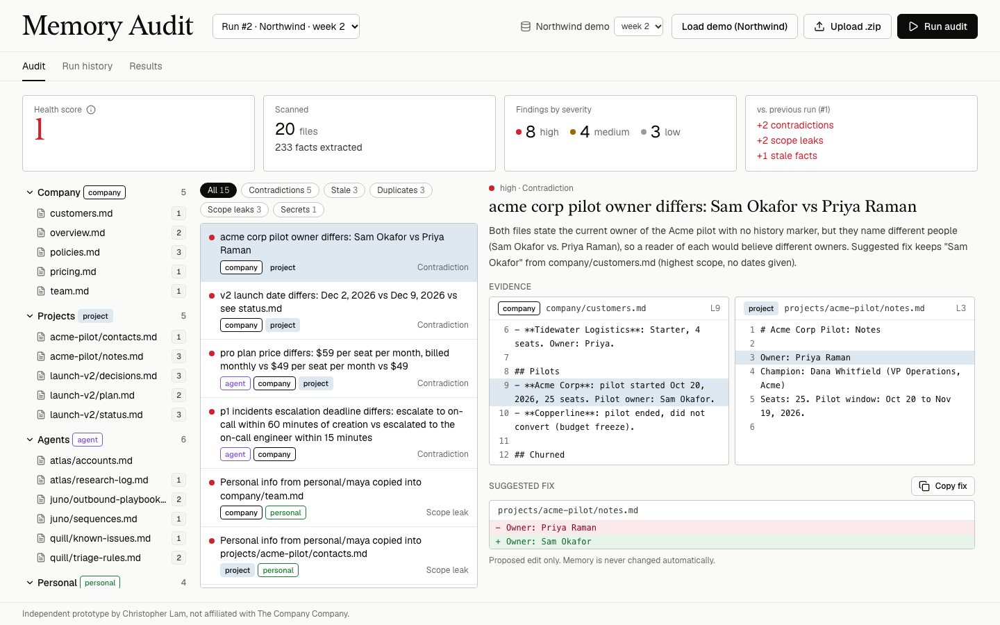

# Memory Audit

Agents that share a Markdown memory folder (`/memories`, split into company, project, agent and personal scopes) write to it all day, and nobody reviews those writes. Over time the folder collects contradictions, stale statuses, near-duplicate facts, personal details copied into shared scopes, and the occasional pasted API key. Memory Audit reads a `/memories` folder or `.zip` export, finds those five problems, and shows each one with the evidence lines from every file involved and an exact suggested edit. It is a local tool and never edits memory itself.



## Results

Northwind fixture: 20 files, 14 planted issues plus decoys (`fixtures/northwind/expected.json`). These numbers come from the app's Results tab and `pnpm test`.

| Check | Planted | Caught (with LLM) | False positives (with LLM) | Caught (no key) | False positives (no key) |
|---|---|---|---|---|---|
| Contradiction | 4 | 4 | 1 | 0 | 0 |
| Stale | 3 | 3 | 0 | 3 | 0 |
| Duplicate | 3 | 3 | 0 | 3 | 0 |
| Scope leak | 3 | 3 | 0 | 3 | 0 |
| Secret | 1 | 1 | 0 | 1 | 0 |
| **Total** | **14** | **14** | **1** | **10** | **0** |

With `claude-haiku-5-5`: 233 facts extracted, cold run about 20 seconds, warm (cached) run under 1 second.

- **The false positive:** the key-merging call grouped "SOC 2 vendor questionnaire status" with the unrelated launch checklist item "SOC 2 report not yet shared with Harbor & Rail", and the judge called them a conflict. The real SOC 2 issue (a status blocked "as of Oct 3", resolved Oct 21) is reported as stale, which is correct.
- **Rough edge:** the duplicate check finds the company one-liner in 2 of its 3 files: the Atlas copy has a prefix that drops similarity below 0.8. It still counts as caught.
- **Without an API key** the four contradictions are missed by design, since they need fact extraction.
- **Variance:** LLM results can shift between prompt or model changes. They are deterministic on re-runs because responses are cached.

Real trial export: _not run yet_.

## How it works

- **Secrets:** regexes for common key formats (`sk-`, `sk-ant-`, `ghp_`, `github_pat_`, `xoxb-`, `AKIA`, PEM private keys) plus a Shannon-entropy check on long tokens. Runs on raw text first; everything after it (other checks, LLM prompts, Postgres, the UI) only sees masked values (first 6 + last 4 characters).
- **Duplicates:** each line or bullet is normalized (lowercase, punctuation and dates removed) and compared with word-shingle Jaccard similarity; pairs at 0.8 or above in different non-personal files are clustered. The fix keeps the highest-scope copy and links the rest.
- **Scope leaks:** 8-word sequences, phone numbers and emails from `personal/<person>/` files that reappear in shared files are flagged directly. Lines with only weaker signals (an email, a phone number, a medical or comp keyword) go to the LLM in one batch, and are dropped when there is no key.
- **Contradictions:** the LLM extracts atomic facts per file (validated with Effect `Schema`, one retry on bad JSON), one call merges differently worded keys, facts about an explicitly previous value are set aside, then each group with differing values gets one judgment call: conflict, history, different context or same. Only conflicts are flagged. The fix keeps the newest dated value, otherwise the highest scope.
- **Stale:** a line worded as upcoming, pending, blocked or due whose date has passed, plus dated facts that a newer dated fact in another file supersedes (groups the judge marked as history, or conflicts where every losing statement is older and dated).

Health score: 100 − 10 per high − 4 per medium − 1 per low, floor 0. LLM responses are cached in Postgres by `sha256(model + prompt)`, so re-runs are instant and free.

## Run locally

Needs Node 22+, pnpm and Docker.

```
cp .env.example .env    # add ANTHROPIC_API_KEY (optional; deterministic checks run without it)
docker compose up -d
pnpm install
pnpm dev                # http://localhost:5173 (API on http://localhost:8787)
pnpm run audit fixtures/northwind/memories   # CLI version
pnpm test
```

Use `pnpm run audit`, not `pnpm audit`: the bare form is pnpm's built-in dependency audit. The CLI also takes a `.zip`, `--save` (store the run in Postgres) and `--today YYYY-MM-DD`.

In the UI: "Load demo (Northwind)" picks the fixture; the week 1 / week 2 selector swaps in a cleaner earlier snapshot (`fixtures/northwind/earlier/`) so two runs can be compared in Run history.

Stack: TypeScript (strict), Effect (services, typed errors, `Schema`), Hono, Postgres 16 via `postgres`, React + Vite + Tailwind + shadcn/ui components, `@anthropic-ai/sdk` with `LLM_MODEL` (default `claude-haiku-5-5`).

## Limitations

- The real `/memories` layout isn't public. Scope rules are inferred and live in `src/engine/scopes.ts` as an ordered prefix list; edit them for a different layout. Unmatched files get scope `unknown` and still go through every check.
- Contradiction quality depends on fact extraction; differently worded facts can land in different groups and be missed.
- Dates without a year are read as the current year.
- The duplicate check is an O(n²) pair scan, fine for a few thousand lines.
- LLM checks cost a few cents per run on Haiku and are cached afterwards.

## Drop-in version

[`skill/memory-audit/SKILL.md`](skill/memory-audit/SKILL.md) is a short skill that tells an agent how to run the same five checks on `/memories` itself and post the findings as a draft for a human to approve.
